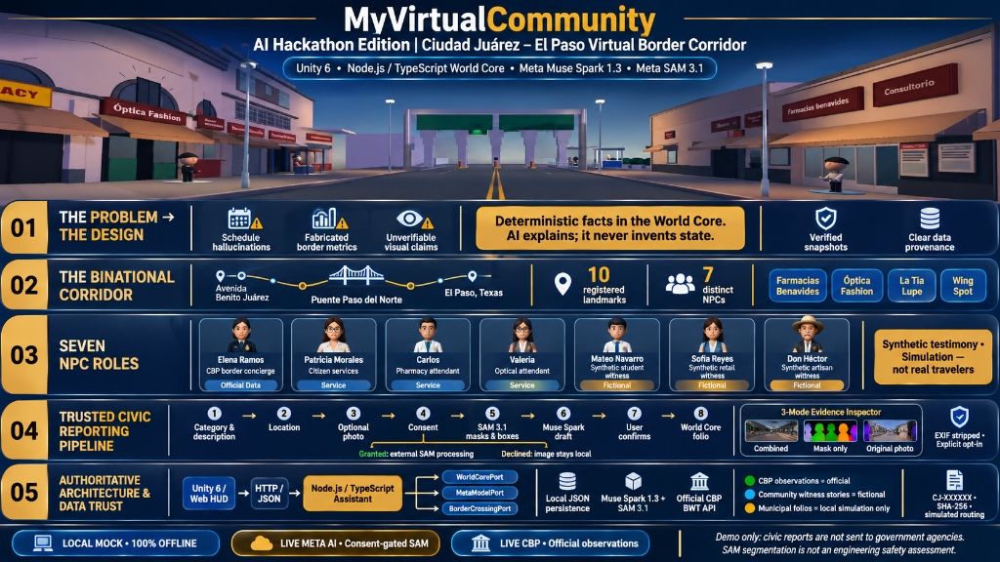
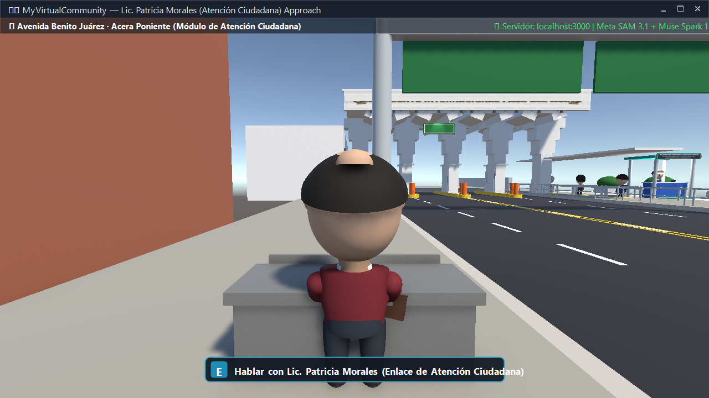
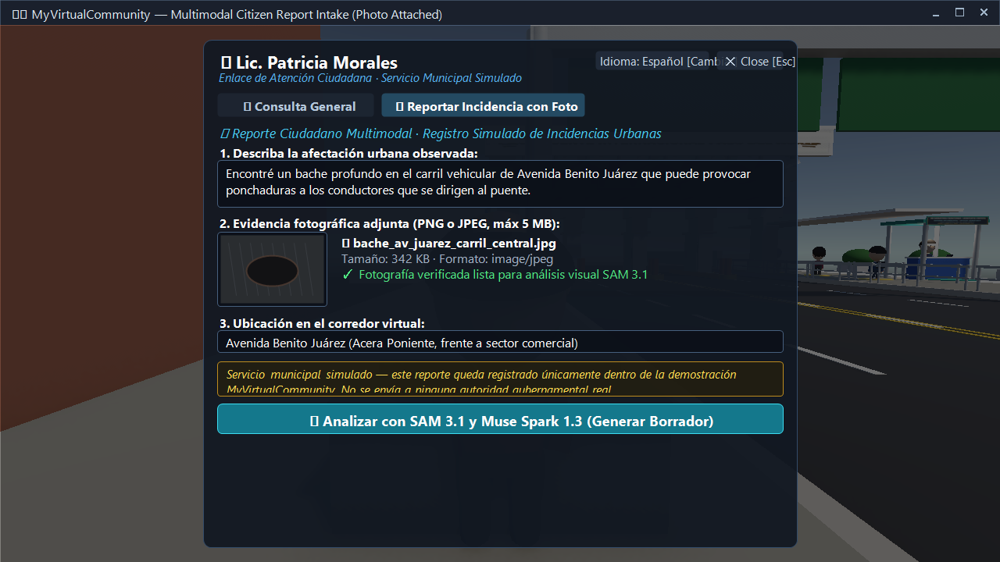
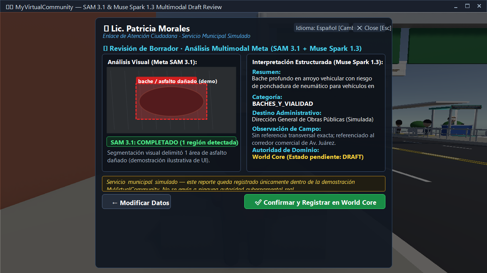
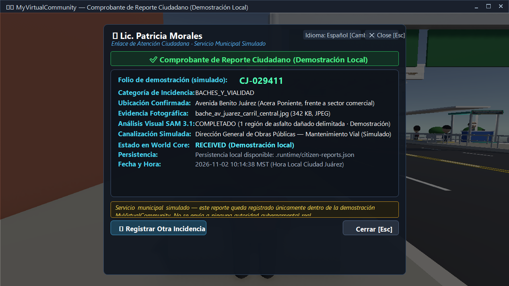

# MyVirtualCommunity — AI Hackathon Edition

An authoritative, grounded multimodal AI foundation and interactive 3D simulation for the **Ciudad Juárez–El Paso international border corridor** (Avenida Benito Juárez and Puente Internacional Paso del Norte).

Built with **Meta Muse Spark 1.3**, **Meta Segment Anything 3.1 (SAM 3.1)**, **Unity 6 (6000.3.25f1)**, and an authoritative **Node.js/TypeScript World Core**.



---

## 1. Project Overview & Problem Statement

In conversational AI applications for local civic environments and international border communities, commercial large language models suffer from three fundamental vulnerabilities:

1. **Schedule Hallucination:** Models frequently invent business opening hours, confuse timezones (such as `America/Ciudad_Juarez` vs. `America/Denver` during daylight saving time offsets), or present outdated schedules as current fact.
2. **Fabricated Border Metrics:** Chatbots routinely fabricate live border wait times or mistake informal eyewitness estimates for official government port-of-entry measurements.
3. **Unverifiable Visual Claims:** Multimodal systems claim to inspect municipal damage or civic issues without providing auditable visual segmentations, masks, or explicit privacy sanitization.

**MyVirtualCommunity (AI Hackathon Edition)** solves these problems through an **authoritative hexagonal architecture** that enforces strict boundaries between deterministic factual truth and generative natural-language synthesis:

- **Authoritative World Core:** Business schedules, admission rules, spatial coordinates, deterministic waypoint movement, and citizen reports are managed deterministically in pure domain code. The generative AI model is never permitted to invent or alter facts.
- **Strict Factual Grounding:** Meta Muse Spark 1.3 is provided with verified atomic snapshots and constrained to natural-language presentation without hallucinating state.
- **Verifiable Visual Segmentation:** Meta SAM 3.1 generates auditable 2D bounding boxes and binary segmentation masks for municipal photographic evidence, with mandatory user consent before any external processing.
- **Clear Data Provenance:** Official U.S. Customs and Border Protection (CBP) pedestrian wait-time observations are strictly separated from the fictional testimonies of simulated synthetic witnesses.

---

## 2. The Ciudad Juárez–El Paso Virtual Corridor

The simulation reproduces the binational urban environment of **Avenida Benito Juárez** in historic downtown Ciudad Juárez, extending north toward the **Puente Internacional Paso del Norte / Santa Fe Street Bridge** crossing into El Paso, Texas:

- **Photographic Architectural Grounding:** Authentic reconstruction grounded in official photographic survey:
  - **East Sidewalk Commercial Block:** Farmacias Benavides, Consultorio Médico, Comercial Uno, Joyería Minerva, Curiosidades Azteca, La Michoacana, and Atención Dental.
  - **West Sidewalk Commercial Block:** Joyería Internacional, Curiosidades Internacional, Farma / Pharmacy, Óptica Fashion, Alimentos Santa Fe, Bar La Cucaracha, Taquería El Trompo, and Dental Jarquín.
- **Calle Gardenias Intersection:** Full civil engineering intersection featuring continuous asphalt roadway, 4 curved corner fillet radii (1.80 m), ADA-compliant yellow tactile curb ramps, zebra crosswalks, designated taxi parking stalls, and dual street nomenclature signposts.
- **Puente Internacional Paso del Norte (PC-51):** Monumental arched concrete canopy, 3D relief blue lane identifiers (1, 2, 3, 4) on toll booth pillars, Fideicomiso surveillance camera easter egg with live YouTube stream, diagonal barricades to Pillar 4, and open pedestrian concourse with Elena Ramos' CBP information kiosk.
- **Dynamic Toll Barrier Gates (Plumas de Peaje):** 4 electromechanical toll barrier units across Arcos 1–4 with animated red/white hazard striped arms, physical collision synchronization, dual-aspect traffic signals (green/red), and live backend World Core control.
- **Citizen Service Relocation:** Lic. Patricia Morales's "Enlace de Atención Ciudadana" municipal kiosk is positioned along the West sidewalk at $Z = 18.55\text{ m}$ directly in front of the white roll-up metal shutter of Building C / Dental Jarquín, leaving the neighboring Taquería El Trompo storefront completely unobstructed.
- **Binational Context:** Real-time port-of-entry dynamics where thousands of students, retail workers, and daily commuters cross between Mexico and the United States.

---

## 3. Main User Experience & Playable Features

The project delivers a fully interactive first-person experience built in **Unity 6 (6000.3.25f1)**:

- **First-Person Corridor Navigation:** Smooth keyboard/mouse movement (`W/A/S/D` to walk, `Shift` to sprint, `Mouse` to look, `Space` to jump) with auto-anchored standing head camera (1.60 m eye level).
- **Proximity & Raycast Interaction:** Aim at any interactive NPC, service desk, or landmark and press `E` to initiate a dialogue or service flow.
- **2D Corridor Architectural Minimap:** Press `M` anytime to toggle a translucent 2D minimap overlay with real-time player orientation cone, avenue boundaries, bridge canopy, and color-coded landmark blips.
- **Real-Time Compass & Orientation Ribbon:** Compass strip displaying player heading degrees (0–359°), cardinal directions (N, NE, E, SE, S, SW, W, NW), and real-time destination hints.
- **Dynamic Auto-Sizing HUD Windows:** Self-measuring, anti-clipping IMGUI windows across the Controls & Exploration Guide (`F1`), Pause Menu (`Esc`), and Settings Drawer. Content height is measured dynamically on repaint, adapting automatically whenever text or options change, with automatic scrollbar fallback on smaller screens.
- **Interactive Live YouTube Camera Easter Egg:** Clickable Fideicomiso surveillance camera mounted on Pillar 1 of the international bridge facade. Clicking opens an interactive Picture-in-Picture (PiP) dark-mode player with a blinking "● LIVE / ● EN VIVO" status badge and a single-click redirect to the official live YouTube camera stream (`https://www.youtube.com/watch?v=IcvugJWPXz8`).
- **Dynamic Border Lane Barrier Control:** Real-time electromechanical toll barrier synchronization between the Unity client and World Core REST API (`GET /api/border/lane-barriers` & `POST /api/border/lane-barriers/:laneId`), with in-game Settings drawer debug toggles.
- **Deterministic NPC Waypoint Patrols & Civil Routines:** 7 corridor NPCs with dynamic patrol routes, civil schedules, and heading interpolation synchronized live from World Core.
- **Interactive NPC Dialogue Trees:** Grounded question chips, custom query text input, and authoritative responses with latency and model badges.
- **Multimodal Citizen Reporting Desk:** Complete intake modal for reporting municipal issues with optional photo attachment, client-side metadata sanitization, SAM 3.1 segmentation preview, and World Core registration.
- **Visual Evidence Inspection Viewer:** Modal inspection tool allowing users to examine original photographs, extracted SAM 3.1 segmentation masks, and blended visual overlays in 3 distinct viewing modes.

---

## 4. NPC Character Guide

The corridor features seven distinct non-player characters (NPCs), each fulfilling an explicit architectural role:

| Character | Role / Identification | Canonical Location | Capabilities & Grounding |
| :--- | :--- | :--- | :--- |
| **Elena Ramos** | **Border Pedestrian Concierge** (`elena-border-concierge`) | Puente Paso del Norte pedestrian queue | Interprets official CBP pedestrian wait times, compares Paso del Norte vs. BOTA (Bridge of the Americas), and explains data freshness. |
| **Lic. Patricia Morales** | **Enlace de Atención Ciudadana** (`patricia-citizen-rep`, alias `patricia-morales`) | Municipal intake desk (Av. Juárez west sidewalk, $Z = 18.55\text{ m}$ in front of Dental Jarquín roll-up shutter) | Intake representative for citywide citizen issue reporting (9 categories), visual evidence validation, and simulated municipal routing. |
| **Carlos Méndez** | **Virtual Storefront Attendant** (`carlos-farmacia-attendant`) | Farmacias Benavides storefront (East sidewalk) | Answers hours, location, and operational inquiries grounded strictly in verified World Core business schedules. |
| **Valeria Domínguez** | **Virtual Storefront Attendant** (`valeria-optica-attendant`) | Óptica Fashion storefront (West sidewalk) | Answers optical service hours, address, and admission policies grounded in authoritative domain data. |
| **Mateo Navarro** | **Synthetic Community Witness** (`mateo-student`) | Puente Paso del Norte queue | 21-year-old UTEP engineering student; shares simulated perspective on daily student commuting. Fictional testimony explicitly disclaimed. |
| **Sofía Reyes** | **Synthetic Community Witness** (`sofia-cross-border-retail`) | Puente Paso del Norte queue | Cross-border retail employee; shares simulated perspective on shopping and pedestrian peak wait times. |
| **Don Héctor Delgado**| **Synthetic Community Witness** (`hector-artisan`) | Puente Paso del Norte queue | Traditional downtown artisan; shares simulated perspective on historical corridor foot traffic and heritage. |

---

## 5. Border Concierge & Official CBP Pedestrian Observations

Stationed at the international crossing, **Elena Ramos** provides orientation to cross-border pedestrians using authoritative data:

- **Official Source Authority:** Pedestrian wait times are ingested from the official **U.S. Customs and Border Protection (CBP) Border Wait Times (BWT) API**.
- **Canonical Ports Compared:**
  - `infrastructure:puente-paso-del-norte` (Paso del Norte / PDN / Santa Fe Bridge — standard pedestrian lane).
  - `infrastructure:puente-cordova-americas` (Bridge of the Americas / BOTA / Libre — standard pedestrian lane).
- **Anti-Hallucination Guardrails:**
  - The model is never permitted to guess or calculate wait times. It only explains the raw numbers returned by the CBP port.
  - Every observation reports its source timestamp, observation age in minutes, lane count, and operational status.
  - If official data is unavailable or the external API is unreachable, the system displays an explicit `Unavailable` badge rather than inventing numbers.

---

## 6. Synthetic Community Witnesses & Fictional Status

To explore community sentiment and cultural nuances of cross-border life without misleading users, the simulation includes **Synthetic Community Witnesses** (Mateo, Sofía, and Don Héctor):

- **Prominent Provenance Markers:** Every response carries an un-bypassable provenance header: `Testigo sintético · Simulación` / `Synthetic witness · Simulation`.
- **Fictional Boundary:** The UI prominently warns: *"Fictional scenario witness. Not an actual traveler. Statements are simulated testimony separate from official CBP bridge measurements."*
- **Role Scoping:** Witnesses cannot modify simulation state, answer municipal intake questions, or alter business hours.

---

## 7. Citizen Reporting Workflow

Citizens can report urban infrastructure problems through **Lic. Patricia Morales**:

```text
[ PLAYER ]
    │
    ▼
1. Select Category (9 Municipal Categories)
    │
    ▼
2. Describe Observed Civic Problem
    │
    ▼
3. Specify Incident Location (Av. Juárez Corridor or Citywide Juárez Sector)
    │
    ▼
4. Optional Photographic Evidence (JPEG / PNG, max 5 MB)
    │
    ├─ If photo attached: User grants/declines external AI processing consent
    │     │
    │     ├─ Consent GRANTED   ──► SAM 3.1 Visual Segmentation (Masks & Boxes)
    │     └─ Consent DECLINED  ──► Image stored locally; external AI skipped
    │
    ▼
5. Generate Report Draft (Meta Muse Spark 1.3 synthesizes structured summary)
    │
    ▼
6. Player Confirmation & Submission
    │
    ▼
7. World Core Atomic Persistence (.runtime/citizen-reports.json)
    │
    ▼
8. Traceable Folio Issued (e.g. CJ-029411) & Simulated Routing
```

### Visual Walkthrough & Evaluator Evidence

The citizen reporting lifecycle and user interface are illustrated below across four interface states:

#### 1. In-World Desk Approach

*Actual in-engine 3D capture: First-person player perspective approaching Lic. Patricia Morales at the simulated municipal citizen attention desk on Avenida Benito Juárez.*

#### 2. Category & Issue Intake Modal

*Actual application HUD interface: Intake modal form supporting 9 municipal categories, detailed problem description, street location, and optional photographic evidence attachment.*

#### 3. Multimodal Draft Review & Segmentation (Illustrative UI Mockup)

*Illustrative UI demonstration layout: Synthetic mockup demonstrating how the draft review screen displays civic issue summaries alongside simulated SAM 3.1 visual segmentation results.*

#### 4. World Core Demonstration Receipt (Local Simulation)

*Local demonstration receipt: Illustrates registration confirmation issued by the local World Core displaying a demonstration folio (`CJ-029411`), simulated department canalization, and local file persistence capability (`Persistencia local disponible: .runtime/citizen-reports.json`) under the `RECEIVED` lifecycle state.*

> **Simulation Notice & Evaluator Transparency:**
> - **Civic Registration:** Citizen reporting operates strictly within the local MyVirtualCommunity demonstration. Folios, receipts, and departmental canalization are simulated by the local World Core and are **not** transmitted to, registered with, or approved by real-world municipal or government authorities.
> - **Demonstration Folio vs. Configured Persistence:** The displayed folio (`CJ-029411`) is fixed demonstration data in the screenshot layout. Local atomic file persistence (`.runtime/citizen-reports.json`) is a genuine backend capability configured in local mode (independently verified by automated restart recovery tests), clearly distinguished from in-memory fixtures.

### SAM 3.1 Evidence Classification & Provenance Matrix

To maintain strict scientific and evaluator integrity, the implementation of **Meta Segment Anything 3.1 (SAM 3.1)** is organized into four distinct evidence layers:

| Layer | Component | Nature & Scope | Verification Method |
| :--- | :--- | :--- | :--- |
| **1. Synthetic UI Illustration** | `screenshots/511_03_sam_and_spark_draft_review.png` | Procedural GDI+ visual layout demonstrating draft review modal layout and bounding box placement. | Evaluator visual reference; does not represent live model execution. |
| **2. Automated Domain Testing** | `tests/domain/sam-mask-overlay.test.ts` | Complete deterministic domain verification of polygon parsing, bounding box arithmetic, run-length mask compositing, and overlay blending on test fixtures. | Automated test suite (`npm test`, 100% passing; does not make external network requests). |
| **3. Provider Adapter Implementation** | `src/adapters/meta-model-api-adapter.ts` | Production SSE streaming pipeline supporting live SAM 3.1 inference when `MODEL_API_KEY` is configured, with graceful fallback. | Architectural contract & mocked unit/integration test coverage (does not constitute automated live external provider testing). |
| **4. Manual User-Observed Inference** | In-engine Visual Evidence Inspector (Unity HUD) | Empirical test session where a real photograph was submitted with user authorization, returning 2 detected segmentation regions verified in the 3-mode visual inspector. | Manual interactive verification during live client evaluation sessions. |

### 9 Municipal Issue Categories
1. **Road Surface & Potholes** (`road-surface-damage`)
2. **Sidewalks & Accessibility** (`sidewalk-obstruction`)
3. **Waste & Public Cleaning** (`cleaning-and-waste`)
4. **Water & Drainage** (`water-and-drainage`)
5. **Public Lighting** (`public-lighting`)
6. **Traffic Signs & Signals** (`traffic-signage`)
7. **Parks & Public Spaces** (`parks-and-public-spaces`)
8. **Urban Trees & Green Areas** (`trees-and-green-areas`)
9. **Other Civic Issues** (`other`)

---

## 8. Meta Muse Spark 1.3 Integration

**Meta Muse Spark 1.3** (`muse-spark-1.3`) is utilized as the core natural-language synthesis engine across four domains:

1. **Business Hours Assistant:** Formulates concise bilingual answers from deterministic operating schedules.
2. **Border Concierge:** Explains bridge wait differences and traveler orientation based strictly on CBP facts.
3. **Synthetic Witnesses:** Generates culturally authentic, character-voiced community perspectives.
4. **Citizen Report Draft Synthesis:** Translates raw citizen descriptions and category selections into clear, professional municipal draft summaries with non-emergency safety assessments.

### Anti-Hallucination Contract
- Temperature and prompt parameters enforce deterministic grounding.
- Prompts include explicit system instructions prohibiting the generation of unverified schedules or wait times.
- If the World Core or CBP API returns an error or empty state, the server returns a structured HTTP 502/503 response and **never calls the language model**.

---

## 9. Meta SAM 3.1 Integration & Photographic Segmentation

When photographic evidence is provided for an urban issue report and external processing is authorized, the system invokes **Meta Segment Anything 3.1 (SAM 3.1)**:

- **Targeted Visual Extraction:** Identifies damaged asphalt, pooling water, fallen trees, garbage heaps, or broken lighting fixtures.
- **Standardized Coordinate Output:** Returns normalized 2D bounding boxes (`ymin`, `xmin`, `ymax`, `xmax`) with detected object labels and confidence scores.
- **Binary Segmentation Masks:** Extracts precise pixel-level masks encoded as RLE or binary bitmasks.
- **Visual Evidence Inspection Viewer:** The Unity client provides an enlarged 3-mode visual inspector:
  1. **Combined Mode:** Blended overlay showing original photograph with translucent SAM masks and bounding boxes.
  2. **Mask Only Mode:** High-contrast binary view showing segmented damage regions on a neutral backdrop.
  3. **Original Photo Mode:** Clean view of the input photograph with metadata stripped.
- **Engineering Disclaimer:** Prominently displays: *"Visual detection and segmentation only — does not certify structural engineering condition, depth, or road safety severity."*

---

## 10. World Core Authority & Persistence

The **World Core** acts as the single source of authoritative simulation state:

- **Hexagonal Decoupling:** Implemented behind `WorldCorePort`. Can run as an in-memory fixture (100% offline) or communicate with an external authoritative simulation over HTTP (`RemoteWorldCoreAdapter`).
- **Atomic File Persistence:** In local mode, citizen reports and simulated municipal tickets are written atomically to `.runtime/citizen-reports.json` using atomic temporary file replacement (`write -> fsync -> rename`), preventing data corruption upon process termination.
- **Traceable Folio Generation:** Every confirmed report receives an immutable identifier (`CJ-XXXXXX`, e.g. `CJ-029411`), cryptographic content hash (SHA-256), and simulated municipal routing department assignment.
- **Authoritative Waypoint Graph & Movement Roster:** Deterministic waypoint network (`CORRIDOR_WAYPOINTS`) and schedule-driven movement profiles for all 7 corridor characters. The client smoothly interpolates presentation transforms towards backend-provided positions without fabricating paths.
- **Authoritative Electromechanical Barrier State:** Maintains the operational open/closed state of the 4 international bridge toll barrier units across Arcos 1–4.

---

## 11. System Architecture & REST API Endpoints

```text
┌────────────────────────────────────────────────────────────────────────┐
│                          PRESENTATION LAYER                            │
│                                                                        │
│   ┌────────────────────────────────┐   ┌───────────────────────────┐   │
│   │     Unity 6 Standalone 3D      │   │    Web Assistant Client   │   │
│   │   (Av. Benito Juárez Client)   │   │     (Browser UI / HUD)    │   │
│   └───────────────┬────────────────┘   └─────────────┬─────────────┘   │
└───────────────────┼──────────────────────────────────┼─────────────────┘
                    │  HTTP / JSON                     │  HTTP / JSON
                    ▼                                  ▼
┌────────────────────────────────────────────────────────────────────────┐
│                        APPLICATION & PORTS LAYER                       │
│                                                                        │
│    ┌─────────────────────────┐        ┌───────────────────────────┐    │
│    │ Assistant Express/HTTP  │◄───────┤ AnswerBusinessHours       │    │
│    │ Server (Port 3000)      │        │ AskBorderConcierge        │    │
│    └──────────┬──────────────┘        │ TalkToSyntheticWitness    │    │
│               │                       │ TalkToBusinessAttendant   │    │
│               ▼                       │ CreateCitizenReportDraft  │    │
│      [ Domain Invariants ]            │ SubmitCitizenReport       │    │
│                                       └─────────────┬─────────────┘    │
└─────────────────────────────────────────────────────┼──────────────────┘
                                                      │
         ┌────────────────────────┬───────────────────┴──────────────────┐
         ▼                        ▼                                      ▼
┌──────────────────┐    ┌──────────────────┐                   ┌──────────────────┐
│  WorldCorePort   │    │  MetaModelPort   │                   │BorderCrossingPort│
└────────┬─────────┘    └────────┬─────────┘                   └────────┬─────────┘
         │                       │                                      │
         ▼                       ▼                                      ▼
┌──────────────────┐    ┌──────────────────┐                   ┌──────────────────┐
│ InMemoryAdapter  │    │ MetaModelApi     │                   │ CbpBorderWait    │
│ (.runtime JSON)  │    │ (Muse Spark 1.3) │                   │ Time Adapter     │
│       OR         │    │ (SAM 3.1)        │                   │ (Official CBP)   │
│ RemoteWorldCore  │    │       OR         │                   └──────────────────┘
└──────────────────┘    │ MockMetaAdapter  │
                        └──────────────────┘
```

### Authoritative Backend REST API

| Method | Endpoint | Description |
| :--- | :--- | :--- |
| `GET` | `/health` | System health check and service identity probe (`status: "ok"`). |
| `GET` | `/api/spatial/corridor` | Spatial corridor metadata and bounding coordinates for Avenida Benito Juárez. |
| `GET` | `/api/businesses` | Canonical business catalog with deterministic operating schedules and admission rules. |
| `GET` | `/api/world/npcs/movement` | Authoritative 7-NPC waypoint movement snapshot (Cartesian positions, headings, progression). |
| `GET` | `/api/world/npcs/activity` | Evaluated NPC routine activity states based on local Ciudad Juárez civil time. |
| `GET` | `/api/world/npcs/interaction-context` | Context-aware dialogue chips and status badges for proximate NPCs. |
| `GET` | `/api/world/environment` | Environmental simulation state (sun azimuth, lighting profile, ambient audio profile). |
| `POST` | `/api/assistant/query` | Structured business hours and admission inquiries. |
| `GET` | `/api/border/wait-times` | Official CBP pedestrian wait-time observations (Paso del Norte & BOTA). |
| `GET` | `/api/border/lane-barriers` | Current physical state of the 4 bridge toll barrier gates (`open` / `closed`). |
| `POST` | `/api/border/lane-barriers/:laneId` | Command toll barrier gate to open, close, or toggle state dynamically. |
| `GET` | `/api/border/witnesses` | Roster of synthetic community witnesses (Mateo, Sofía, Don Héctor). |
| `POST` | `/api/border/witnesses/chat` | Conversational endpoint for synthetic witness dialogue with provenance disclosures. |
| `GET` | `/api/border/concierge` | Concierge status and port overview for Elena Ramos. |
| `POST` | `/api/border/concierge/chat` | Conversational endpoint for border wait-time orientation. |
| `GET` | `/api/businesses/attendants` | Storefront attendants catalog (Carlos Méndez & Valeria Domínguez). |
| `POST` | `/api/businesses/attendants/chat` | Conversational endpoint for storefront attendants. |
| `GET` | `/api/citizen-reports/representative`| Municipal representative profile (Lic. Patricia Morales). |
| `GET` | `/api/citizen-reports/categories` | Catalog of 9 supported municipal issue categories. |
| `POST` | `/api/citizen-reports/draft` | Synthesize citizen issue report draft with optional SAM 3.1 visual evidence. |
| `POST` | `/api/citizen-reports/submit` | Confirm and atomically persist citizen report with issued tracking folio. |
| `GET` | `/api/citizen-reports` | List confirmed reports persisted in local World Core storage. |

---

## 12. Technologies & Prerequisites

### System Requirements
- **Operating System:** Windows 10 / 11 (64-bit)
- **Node.js:** v20.18.0 or higher (v20.19.0+ recommended)
- **PowerShell:** Windows PowerShell 5.1 or PowerShell 7+
- **Unity Engine:** Unity 6 (`6000.3.25f1`) (required for building from source)
- **Graphics:** DirectX 11 / DirectX 12 capable GPU (for Unity Standalone client)
- **Disk Space:** ~350 MB free disk space (repository + Standalone package)

---

## 13. Environment Configuration

The application requires zero mandatory configuration to run in **Local Mock Mode**.

To enable live Meta AI features or connect to an external World Core, create a `.env` file in the repository root:

```bash
# Copy template
cp .env.example .env
```

### Supported Environment Variables

| Variable | Required | Default | Description |
| :--- | :--- | :--- | :--- |
| `MODEL_API_KEY` | Optional | *None* | Meta Model API Key. When provided, enables live Muse Spark 1.3 and SAM 3.1 calls. |
| `MODEL_API_BASE_URL` | Optional | `https://api.meta.ai/v1` | Endpoint URL for the Meta Model API. |
| `MODEL_NAME` | Optional | `muse-spark-1.3` | Model identifier for text and draft synthesis. |
| `PORT` | Optional | `3000` | Port for the local Node.js Assistant & World Core server. |
| `HOST` | Optional | `127.0.0.1` | Host address to bind the local server. |
| `WORLD_CORE_BASE_URL` | Optional | *None* | When set, proxies World Core calls to an external HTTP server. |

> [!NOTE]
> In accordance with strict security standards, API keys are masked in logs and diagnostic outputs (`[CONFIGURED]` or `[NOT CONFIGURED]`). Keys and `.env` files are never tracked in version control.

---

## 14. Installation & Evaluator Quickstart

### Step 1: Clone Repository & Install Dependencies
Open PowerShell in your terminal:

```powershell
git clone https://github.com/lmartinez51/MyVirtualCommunity-AI-Hackathon-Edition.git
cd MyVirtualCommunity-AI-Hackathon-Edition
npm install
```

### Step 2: Ensure Standalone Client Is Available
The verified Windows Standalone client package is provided in `Builds/Release/MyVirtualCommunity-Windows-x64.zip`.

If you received the repository with the prebuilt client in `unity-client/Builds/Windows/`, the launcher will find it automatically. Otherwise, extract the zip:

```powershell
Expand-Archive -Path "Builds\Release\MyVirtualCommunity-Windows-x64.zip" -DestinationPath "unity-client\Builds\Windows"
```

### Step 3: Run the Evaluator Launcher
Execute the unified, process-safe demonstration launcher:

```powershell
.\scripts\launch-demo.ps1
```

*Or via npm shortcut:*
```powershell
npm run demo
```

The launcher performs all of the following automatically:
1. Validates Node.js prerequisites and dependencies.
2. Checks port 3000 availability (reports conflicts safely without killing unrelated processes).
3. Spawns the local backend server.
4. Polls `http://127.0.0.1:3000/health` until ready.
5. Locates and launches `MyVirtualCommunity.exe`.
6. Waits for the Unity game process to exit.
7. Cleanly terminates **only** the backend process tree spawned by the launcher upon exit.

---

## 15. Operating Modes: Mock vs. Live Integration

The platform supports three clearly delineated operating modes:

### Mode A: Local World Core with Mock AI (100% Offline)
- **Configuration:** No `MODEL_API_KEY` in `.env` (or `.env` absent).
- **Behavior:** The backend automatically boots `MockMetaModelAdapter` and `InMemoryWorldCoreAdapter`.
- **Capabilities:** Fully functional NPC dialogue, business inquiries, draft generation, and simulated citizen reporting.
- **External Dependencies:** Zero. No network access required for AI features.
- **CBP Behavior:** If internet access is unavailable, Border Concierge displays an explicit `Unavailable` observation badge without crashing.

### Mode B: Live Meta AI Mode (Muse Spark 1.3 & SAM 3.1)
- **Configuration:** Set `MODEL_API_KEY=your_actual_key` in `.env`.
- **Behavior:** Direct live API requests to Meta Muse Spark 1.3 for text generation and SAM 3.1 for photographic segmentation.
- **Privacy Enforcement:** SAM 3.1 image segmentation is executed **only** if the citizen explicitly clicks `Authorize External Visual Processing` in the reporting UI. If declined, the image remains strictly local and SAM is bypassed.

### Mode C: Live External CBP Border Data
- **Source:** Queries `https://bwt.cbp.gov/api/borderwaittimes` in real-time.
- **Connectivity:** Requires outbound internet access to the official U.S. government endpoint.
- **Fallback:** If CBP is unreachable or rate-limited, the system falls back gracefully to bounded in-memory caching or presents an explicit unavailable notice. It never fabricates simulated wait times as real data.

---

## 16. Evaluator Golden Path Walkthrough

Follow this 16-step walkthrough to evaluate the complete integrated experience:

1. **Launch:** Run `.\scripts\launch-demo.ps1`. The console confirms backend health and boots the Unity client.
2. **Corridor Entry:** You spawn on the sidewalk of Avenida Benito Juárez facing north toward the international bridge. Press `F1` to inspect the dynamic auto-sized Controls Guide; press `Esc` to resume.
3. **2D Minimap & Compass:** Press `M` to toggle the 2D corridor minimap. Observe your real-time heading and landmark blips. Look at the top compass ribbon.
4. **Storefront Interaction:** Walk to **Farmacias Benavides** on the east sidewalk. Aim at **Carlos Méndez** and press `E`.
5. **Authoritative Hours Query:** Ask *"¿A qué hora cierran hoy?"* Observe the instantaneous grounded response derived from World Core operating schedules.
6. **Optical Store Attendant:** Walk across to **Óptica Fashion** on the west sidewalk. Aim at **Valeria Domínguez** and press `E`. Inquire about eye exam appointments and admission status.
7. **Citizen Reporting Desk:** Walk north along the west sidewalk past Taquería El Trompo to the "Enlace de Atención Ciudadana" municipal kiosk in front of the white roll-up shutter ($Z = 18.55\text{ m}$). Aim at **Lic. Patricia Morales** and press `E`.
8. **Issue Description & Photo Evidence:** Select category **Roads & Potholes** (or Water & Drainage). Type a description: *"Bache profundo con fuga de agua en carril poniente"*. Click **Attach Photograph (Optional)** and choose a sample image.
9. **Privacy Consent Choice & Draft Review:** Choose whether to authorize external AI processing. Click **Generate Report Draft**. When the draft appears, click the photograph thumbnail to open the **Enlarged Visual Evidence Viewer**. Toggle between *Combined*, *Mask Only*, and *Original Photo* modes. Close inspector.
10. **Submit & Confirm:** Click **Confirm & Submit to World Core**. A confirmed municipal folio (e.g. `CJ-029411`) is issued and persisted to disk.
11. **Calle Gardenias Intersection:** Continue walking north across the authentic Calle Gardenias intersection with curved corners, ADA tactile yellow ramps, and zebra crosswalks.
12. **Bridge Approach & Toll Barriers:** Approach the monumental canopy of **Puente Paso del Norte**. Inspect the 4 electromechanical toll barrier units (plumas) and blue numbers 1–4 across Arcos 1–4.
13. **Live Camera Easter Egg:** Aim at the Fideicomiso surveillance camera on Pillar 1 and click it. Watch the interactive PiP video player with blinking "● LIVE" badge open, and click to view the live YouTube stream of the bridge.
14. **Border Concierge:** Walk to the pedestrian plaza on the east side of the bridge. Aim at **Elena Ramos** (`Border Pedestrian Concierge`) and press `E`.
15. **Live CBP Wait Time:** Ask *"How long is the pedestrian wait at Paso del Norte?"* Notice the verified observation with source timestamp and lane count, or click the chip comparing **Paso del Norte vs. BOTA**.
16. **Synthetic Witness Perspectives:** Aim at **Mateo Navarro** (student with backpack) in the pedestrian queue and press `E`. Read the synthetic testimony disclosure and ask about his commute to UTEP. Press `ESC` to open the Pause Menu, click **Quit to Desktop**, and verify clean launcher termination.

---

## 17. Automated Testing & Verification Suite

The repository includes a comprehensive, multi-layer automated test suite ensuring factual grounding, domain invariants, and regression safety:

```powershell
# Run all automated tests (527 tests across 39 suites)
npm test
```

### Key Verification Suites

| Command | Scope & Verified Invariants |
| :--- | :--- |
| `npm test` | Complete test runner executing all 39 unit, domain, integration, and API test suites (**527/527 passing**). |
| `npm run build` | TypeScript static type verification (`tsc --noEmit`, 0 errors). |
| `npm run test:integration` | End-to-end HTTP integration test against an external World Core instance (`WORLD_CORE_BASE_URL`). |
| `npm run verify:npcs` | Validates conversational integrity and provenance disclosures across all 7 corridor NPCs. |
| `npm run verify:recovery` | Asserts atomic file persistence and zero-loss restart recovery of `.runtime/citizen-reports.json`. |
| `npm run test:launcher` | Tests launcher process isolation, port availability checks, and clean teardown. |

---

## 18. Privacy, Consent, Geographic Coverage & Boundaries

- **Photographic Privacy:** Photographs undergo client-side dimension and format validation. Exif metadata is scrubbed. External transmission occurs only with explicit opt-in consent.
- **Emergency Limitation:** The reporting desk is strictly for non-urgent municipal issues. Reports describing active fires, violent crimes, or medical emergencies trigger immediate guidance directing the user to real-world 911 emergency services.
- **Geographic Bounding:** The detailed 3D demonstration corridor covers Avenida Benito Juárez from the commercial zone to the international bridge (`IN_DEMO_CORRIDOR`). Citywide Ciudad Juárez reports are accepted and classified descriptively (`OUTSIDE_DEMO_COVERAGE`) without inventing artificial street coordinates.
- **Municipal Simulation Disclosure:** The reporting service is a high-fidelity demonstration. Reports are recorded in the local World Core and are not transmitted to municipal government agencies of Ciudad Juárez.

---

## 19. Known Limitations

- **Standalone Audio:** Audio cues are synthesized through standard Unity audio listeners; custom voiceover recordings are not included in this edition.
- **BWT Update Latency:** CBP updates pedestrian wait times intermittently (typically every 15–45 minutes). The system faithfully reflects CBP update cadence and does not interpolate artificially between official updates.
- **Citywide 3D Coverage:** The playable 3D environment represents the Avenida Benito Juárez corridor; other Ciudad Juárez sectors are supported at the data and routing level, but do not possess custom 3D geometry in this milestone.

---

## 20. Windows Standalone Distribution

The complete, verified Windows Standalone client package is packaged as an independent zip archive:

- **Archive Location:** `Builds/Release/MyVirtualCommunity-Windows-x64.zip`
- **Archive Size:** 37.69 MB (39,520,012 bytes)
- **Uncompressed Size:** 105.92 MB (111,061,683 bytes)
- **SHA-256 Checksum:**
  ```text
  A3B619F7D32E54BD94DCC3DF3DF11988BE62C6A671B26B8ADA7E68932A99715E
  ```
- **Package Contents:**
  - `MyVirtualCommunity.exe` (Unity 6 Standalone executable)
  - `UnityPlayer.dll` (Unity 6 runtime core engine)
  - `UnityCrashHandler64.exe` (Crash telemetry)
  - `MyVirtualCommunity_Data/` (Compiled scenes, asset bundles, managed assemblies)
  - `MonoBleedingEdge/` (Mono runtime environment)
  - `D3D12/` (DirectX 12 rendering binaries)

To verify the archive checksum in PowerShell:
```powershell
Get-FileHash -Path "Builds\Release\MyVirtualCommunity-Windows-x64.zip" -Algorithm SHA256
```

---

## 21. License & Third-Party Attributions

- **Codebase License:** MIT License. See [LICENSE](LICENSE) for details.
- **Meta AI Models:** Meta Muse Spark 1.3 and Segment Anything 3.1 (SAM 3.1) are accessed pursuant to Meta API terms and model licenses.
- **Border Data:** Public border crossing observation data provided by the U.S. Customs and Border Protection (CBP) Border Wait Time API.
- **Unity Engine:** Built with Unity 6 (`6000.3.25f1`). Personal/Educational License.
- **Community Context:** Inspired by and dedicated to the resilient border community of Ciudad Juárez, Chihuahua, and El Paso, Texas.
