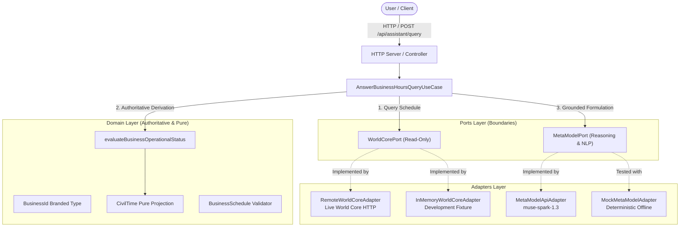
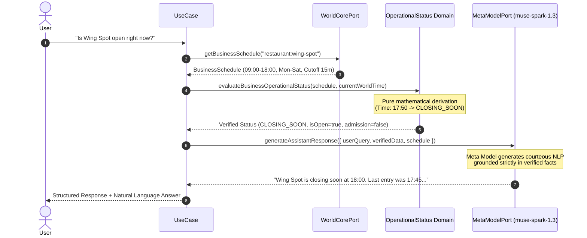

# Architecture Specification

## 1. Overview

The **MyVirtualCommunity AI Assistant** is designed using **Hexagonal Architecture (Ports and Adapters)**. The primary objective is to guarantee that user-facing AI assistants communicate authoritative operational truth without hallucinating schedules, confusing timezones, or inventing open/closed statuses.



---

## 2. Architectural Layers

### 2.1 Domain Layer (`src/domain/`)
The core domain is completely decoupled from frameworks, transport layers, and external APIs.
- **`business-id.ts`**: Branded string type `<category>:<slug>` (e.g. `restaurant:wing-spot`). Prevents string confusion and enforces lowercase kebab-case naming.
- **`civil-time.ts`**: Pure mathematical projection:
  $$\text{UTC Instant} + \text{IANA Timezone} \longrightarrow \text{CivilTime}$$
  Preserves year, month (1-12), day, hour (0-23), minute, second, millisecond, and day-of-week (0=Sunday ... 6=Saturday). Uses native Node.js `Intl.DateTimeFormat`.
- **`business-schedule.ts`**: Strongly typed operating hours, operating days, admission cutoff window (`lastEntryCutoffMinutes`), and optional holiday/closure overrides.
- **`operational-status.ts`**: Authoritative evaluation function `evaluateBusinessOperationalStatus(schedule, evaluatedAt)`. Computes:
  - `OPEN`: Time is within operating hours and before the admission cutoff.
  - `CLOSING_SOON`: Time is within operating hours but after the admission cutoff (e.g. within 15 minutes of closing). New customer admissions are rejected.
  - `CLOSED`: Time is outside operating hours, before opening, after closing, or on a non-operating day (e.g. Sunday).
  - `SPECIAL_CLOSURE`: Matches a scheduled date in `closureOverrides`.

### 2.2 Ports Layer (`src/ports/`)
Defines the boundary contracts required by the application:
- **`WorldCorePort`**: Read-only boundary querying business schedules and world time. Enforces the World Core invariant that external services and AI models never mutate authoritative world state directly.
- **`MetaModelPort`**: Interface for LLM interactions. Accepts an `AssistantPromptContext` containing verified domain facts, returning a `MetaModelResponse`.

### 2.3 Adapters Layer (`src/adapters/`)
Implements the ports for specific environments:
- **`RemoteWorldCoreAdapter`**: Communicates with the live authoritative World Core server over HTTP (`GET /api/businesses/:businessId/schedule`). Validates received JSON at runtime, maps operational status into domain types, and never fabricates mock data or fallback schedules on failure.
- **`InMemoryWorldCoreAdapter`**: A development fixture loaded with realistic Ciudad Juárez businesses (Wing Spot Gómez Morín and Pastelerías La Tía Lupe). Provides simulated world-clock overrides for testing time transitions.
- **`MetaModelApiAdapter`**: Connects to the official Meta Model API (`https://api.meta.ai/v1/chat/completions`) using native Node.js `fetch`. Targets `muse-spark-1.3` by default with bearer token authentication. Contains sanitization safeguards to prevent API keys from appearing in logs or error traces.
- **`MockMetaModelAdapter`**: Fully offline mock returning structured natural language answers matching verified operational status. Used in all automated tests to ensure zero external network calls and zero credit consumption.

### 2.4 Application Layer (`src/application/`)
- **`AnswerBusinessHoursQueryUseCase`**: Coordinates the retrieval of the schedule from `WorldCorePort`, computes the operational status using the pure domain function, packages verified facts into a structured prompt, and passes it to `MetaModelPort`.

### 2.5 Server Layer (`src/server/`)
- Lightweight HTTP server built with native `node:http`. Provides JSON endpoints:
  - `GET /health`
  - `GET /api/businesses`
  - `GET /api/businesses/:id/status?at=...`
  - `POST /api/assistant/query`

---

## 3. Grounding & Anti-Hallucination Invariant



**Key Invariant:**
The language model is **never** asked "Is the business open?" or "What are its hours?". The business hours and operational status are resolved **before** the model is called. The model's role is strictly confined to natural language synthesis grounded in verified data.

---

## 4. World Core Integration Requirements

To replace the `InMemoryWorldCoreAdapter` with a production World Core connection in future phases:
1. **Endpoint in World Core**: The World Core HTTP server must expose a read-only endpoint, for example:
   ```http
   GET /api/businesses/:businessId/schedule
   ```
2. **Adapter Implementation**: Implement `RemoteWorldCoreAdapter implements WorldCorePort` that calls this endpoint.
3. **Dependency Injection**: Inject `RemoteWorldCoreAdapter` into `AnswerBusinessHoursQueryUseCase` in `src/server/index.ts`. No domain or application code changes will be required.
