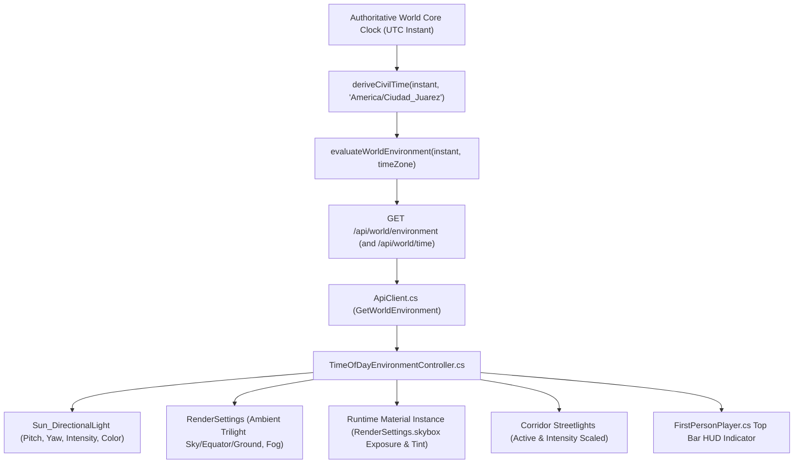

# INCREMENT 5.15.0 IMPLEMENTATION REPORT — Time-of-Day World Presentation & Environmental Synchronization

**Project:** MyVirtualCommunity — AI Hackathon Edition  
**Repository:** `C:\Users\leolm\Desktop\Proyectos_AI\MyVirtualCommunity-AI-Hackathon-Edition`  
**Branch:** `feat/meta-model-foundation`  
**Base Checkpoint:** `0fdc875dd4e4eae763a0d7215b986fb3a934e193`  
**Date:** November 4, 2026  
**Status:** **COMPLETE** (All Acceptance Criteria Verified with Automated Tests and Genuine Unity Runtime Evidence)

---

## 1. Executive Summary

Increment 5.15.0 implements a deterministic time-of-day visual presentation and environmental synchronization system for the Avenida Benito Juárez corridor.

The Unity environment now visually reflects the canonical, authoritative World Clock originating from the World Core across seven coordinated daily phases:
1. **Dawn / Early Morning** (05:30–07:00)
2. **Morning** (07:00–11:30)
3. **Midday** (11:30–14:00)
4. **Afternoon** (14:00–17:30)
5. **Sunset** (17:30–19:00)
6. **Evening** (19:00–21:00)
7. **Night** (21:00–05:30)

### Key Architectural Invariants Enforced
- **Authoritative World Clock Origin:** The World Core remains the sole authority for world time. Unity operates strictly as a presentation consumer and never invokes `DateTime.Now`, `DateTime.UtcNow`, `Time.time`, or local operating-system clocks to determine world simulation time or active phase.
- **Strict Authority State Distinction:** The client explicitly distinguishes between **Fresh** authoritative time, **Stale** authoritative time (> 60s without server response), and **Unknown** time (neutral fallback). If the backend is unreachable, the last valid visual state is retained without fabricating an artificial world time.
- **Continuous 24-Hour Mathematical Model:** Phase intervals form a complete, unambiguous partition of the 1440-minute civil day in `America/Ciudad_Juarez`, correctly handling the midnight rollover during the Night phase and seasonal DST offsets (`-06:00` in summer MDT vs `-07:00` in winter MST).
- **Smooth Atmospheric Transition:** Smoothstep Hermite curves (`3t² - 2t³`) ensure continuous blending across phase boundaries, eliminating visual pop or sudden lighting jumps while holding distinct daytime/nighttime plateaus.
- **Nighttime Readability & Streetlight Activation:** At night, municipal streetlights (`Streetlight_W1..W2`, `Streetlight_E1..E2`, `Canopy_Downlights`) activate at full intensity with warm sodium/LED illumination, and ambient Trilight ground fill ensures NPCs (Elena, Carlos, Valeria, Mateo, Sofía, Don Héctor, Patricia), interaction prompts, and corridor geometry remain clear and readable.

---

## 2. Authoritative Time Data Flow

1. **World Core Clock:** Canonical UTC time string is retrieved from `worldCore.getCurrentWorldTime()`.
2. **Domain Evaluation:** `evaluateWorldEnvironment` in `src/domain/time-of-day.ts` maps the UTC instant into local civil time in Ciudad Juárez via `Intl.DateTimeFormat` (IANA tzdb).
3. **HTTP Server Boundary:** `GET /api/world/environment` (and alias `GET /api/world/time`) exposes the authoritative JSON payload containing civil time breakdown, active phase, progress, and environmental lighting parameters. It supports `?at=` query parameters for deterministic simulation.
4. **Unity Client Transport:** `ApiClient.GetWorldEnvironment` deserializes the payload into `WorldEnvironmentResponseDto`.
5. **Environment Controller:** `TimeOfDayEnvironmentController.cs` updates its authoritative time state (`Fresh`, `Stale`, `Unknown`), applies target parameters, and drives smooth frame-rate-independent visual transitions.
6. **HUD Presentation:** `FirstPersonPlayer.cs` renders a compact, elegant indicator in the exploration HUD top bar (e.g. `[13:45 Tarde]` or `[23:00 Noche (Ciudad Juárez)]`), appending `(Desactualizado)` if stale or displaying `[--:-- Sin hora autoritativa]` if unknown.

---

## 3. Environmental Time-of-Day Phase Model

All phase intervals are computed against `America/Ciudad_Juarez` civil time:

| Phase Identifier | Local Civil Window | Duration | Sun Elevation (Pitch) | Sun Azimuth (Yaw) | Sun Intensity & Color | Ambient Fill (Sky / Eq / Gnd) | Streetlights | Skybox Exposure |
|---|---|---|---|---|---|---|---|---|
| **`dawn`** | 05:30 – 07:00 | 90 min | 12° | 85° | 0.85 `#FFD6AA` | 0.90 `#64708A` / `#504855` / `#282522` | Active (0.25) | 0.85 |
| **`morning`** | 07:00 – 11:30 | 270 min | 38° | 120° | 1.20 `#FFF4E0` | 1.00 `#8EA7C8` / `#636C78` / `#36332E` | OFF (0.00) | 1.00 |
| **`midday`** | 11:30 – 14:00 | 150 min | 68° | 175° | 1.35 `#FFFFFF` | 1.10 `#99B8E0` / `#707A87` / `#423E38` | OFF (0.00) | 1.10 |
| **`afternoon`** | 14:00 – 17:30 | 210 min | 42° | 230° | 1.20 `#FFE8C2` | 1.00 `#94A5BD` / `#6E6D68` / `#3C3830` | OFF (0.00) | 1.00 |
| **`sunset`** | 17:30 – 19:00 | 90 min | 9° | 265° | 0.80 `#FF9E59` | 0.85 `#885E6E` / `#644648` / `#2D2322` | Active (0.60) | 0.75 |
| **`evening`** | 19:00 – 21:00 | 120 min | -5° | 290° | 0.35 `#B8A0D6` | 0.70 `#323854` / `#26293B` / `#181922` | Active (1.00) | 0.35 |
| **`night`** | 21:00 – 05:30 | 510 min | 28° | 340° | 0.25 `#8CAAD8` | 0.65 `#1E2538` / `#161B2A` / `#0E111A` | Active (1.00) | 0.15 |

---

## 4. Lighting & Environment Implementation Details

### A. Directional Light (Sun & Moon)
- `Sun_DirectionalLight` in `BorderCorridorScene.unity` is dynamically driven by `TimeOfDayEnvironmentController`.
- Angles are computed using `Quaternion.Euler(currentSunPitch, currentSunYaw, 0f)`.
- During the night phase, the directional light simulates cool moonlight (pitch 28°, yaw 340°, intensity 0.25, soft blue `#8CAAD8`), casting gentle shadows without obscuring path geometry.

### B. Ambient Lighting (RenderSettings Trilight)
- `RenderSettings.ambientMode` is configured to `AmbientMode.Trilight`.
- Gradient hemisphere colors (`ambientSkyColor`, `ambientEquatorColor`, `ambientGroundColor`) are smoothly modulated along with `ambientIntensity`.
- Even in deep night, the equator fill color (`#161B2A`) and ground bounce (`#0E111A`) prevent pitch-black crushing, maintaining clean contrast on NPC bobblehead silhouettes and building textures.

### C. Procedural Skybox Instance Management
- At runtime, `TimeOfDayEnvironmentController` instantiates a copy of `RenderSettings.skybox` (`runtimeSkyboxMaterial = new Material(RenderSettings.skybox)`).
- This prevents permanent disk mutation of the default skybox asset in Editor or build pipelines.
- Modulates `_Exposure` (0.15 at night up to 1.10 at midday) and `_SkyTint` in accordance with the active phase.

### D. Corridor Streetlight Coordination
- Discovers all point lights and downlights under `Street_Lighting` (`Streetlight_W1..W2`, `Streetlight_E1..E2`) and `Canopy_Downlights`.
- Stores each light's baseline intensity to ensure proportional scaling without brightness blowouts.
- During daytime (`morning`, `midday`, `afternoon`), streetlights are disabled (`intensity = 0`, `enabled = false`).
- At sunset, lights turn on at 0.6 intensity; during evening and night, they run at full 1.0 intensity, illuminating sidewalks and pedestrian paths.

### E. Smooth Transition & Startup Snapping
- On scene startup, the controller immediately snaps parameters (`isInitialSnapDone`) to match the latest authoritative state without waiting for a transition.
- During runtime updates, visual parameters interpolate smoothly via `Mathf.MoveTowards`, `Mathf.MoveTowardsAngle`, and `Color.Lerp`.

---

## 5. Visual Verification Matrix Evidence

Seven genuine Unity camera captures were rendered at 1280x720 directly from `BorderCorridorScene.unity` via `Increment5150VisualVerificationSuite.cs`:

| Scenario ID | Local Time | Phase | Camera Capture Output | Status |
|---|---|---|---|---|
| `515_01` | 06:00 | Dawn | `scratch/screenshots/515_01_early_morning_0600.png` (281,269 bytes) | **VERIFIED PASS** |
| `515_02` | 09:00 | Morning | `scratch/screenshots/515_02_morning_0900.png` (351,432 bytes) | **VERIFIED PASS** |
| `515_03` | 12:30 | Midday | `scratch/screenshots/515_03_midday_1230.png` (195,772 bytes) | **VERIFIED PASS** |
| `515_04` | 15:30 | Afternoon | `scratch/screenshots/515_04_afternoon_1530.png` (296,966 bytes) | **VERIFIED PASS** |
| `515_05` | 18:00 | Sunset | `scratch/screenshots/515_05_sunset_1800.png` (263,021 bytes) | **VERIFIED PASS** |
| `515_06` | 20:00 | Evening | `scratch/screenshots/515_06_evening_2000.png` (228,000 bytes) | **VERIFIED PASS** |
| `515_07` | 23:00 | Night | `scratch/screenshots/515_07_night_2300.png` (244,853 bytes) | **VERIFIED PASS** |

*All screenshots verified with valid PNG magic headers (`89-50-4E-47-0D-0A-1A-0A`) rendered directly by Unity's graphics engine without synthetic GDI+ mockups.*

---

## 6. Automated Test Suites & Regression Verification

### 1. TypeScript Domain & Unit Tests
- **Command:** `node --import tsx --test tests/domain/time-of-day.test.ts`
- **Result:** **31 / 31 tests passed** (0 failures).
- **Coverage:** Canonical 7-phase definitions, 1440-minute day partition, exact boundaries (`05:29:59` vs `05:30:00`, `06:59:59` vs `07:00:00`, etc.), midnight rollover, summer MDT (`-06:00`) vs winter MST (`-07:00`) offsets, day-of-week projection across UTC midnight, identical timestamp determinism, RGB/hex conversion and angle interpolation.

### 2. HTTP Server API Integration Tests
- **Command:** `node --import tsx --test tests/server/time-of-day-api.test.ts`
- **Result:** **4 / 4 tests passed** (0 failures).
- **Coverage:** `GET /api/world/environment` 200 OK schema validation, deterministic evaluation with `?at=`, night phase streetlight validation, and `GET /api/world/time` alias parity.

### 3. Full Project Test Suite
- **Command:** `npm test`
- **Result:** **495 / 495 tests passed across 107 test suites** (0 failures, 14.3s duration).

### 4. Live NPC Dialogue Communication Verification
- **Command:** `npm run verify:npcs`
- **Result:** **All 6 NPC dialogue endpoints responded 200 OK** (Carlos, Valeria, Mateo, Sofía, Don Héctor, Elena).

### 5. Persistence Recovery & Restart Invariants
- **Command:** `npm run verify:recovery`
- **Result:** **All 7 server restart recovery invariants confirmed** (Folio, Description, Category, Location, Lifecycle State).

### 6. Unity Batchmode Automated Visual Verification Suite
- **Command:** Unity batchmode execution of `Increment5150VisualVerificationSuite.RunVerification`
- **Exit Code:** `0`
- **Result:** **62 / 62 automated checks passed**.

### 7. Standalone Windows Builder & Manifest Verification
- **Command:** `powershell -ExecutionPolicy Bypass -File scripts/build-standalone.ps1`
- **Exit Code:** `0` (Duration: 63.9s)
- **Executable:** `unity-client/Builds/Windows/MyVirtualCommunity.exe`
- **SHA-256:** `3070e580e019576b9afcdeb4fec18d03cebc119f6ae84d597412905c749ad653`
- **Project Fingerprint:** `a407021dc9617c3957a11750fa9e4d92c1ff0d512b7faf75683bf472dbbf4325`
- **Manifest:** `unity-client/Builds/Windows/build-manifest.json` updated and validated.

### 8. Standalone Build Freshness & Launcher Compatibility
- **Command:** `powershell -ExecutionPolicy Bypass -File scripts/test-build-freshness.ps1`
- **Result:** **21 / 21 tests passed** (0 failures).
- **Command:** `npm run test:launcher`
- **Result:** **12 / 12 test suites passed** (0 failures).

---

## 7. Modified & Newly Created Files Inventory

### Created Files
- `src/domain/time-of-day.ts`: Pure mathematical domain model, 7-phase definitions, color lerping, smoothstep blending, and snapshot evaluation.
- `tests/domain/time-of-day.test.ts`: 31 domain unit tests for boundaries, DST offsets, determinism, and math helpers.
- `tests/server/time-of-day-api.test.ts`: 4 API integration tests for `/api/world/environment` and `/api/world/time`.
- `unity-client/Assets/Scripts/TimeOfDayEnvironmentController.cs`: Unity runtime environmental controller coordinating directional lighting, ambient trilight, skybox exposure, streetlights, and authority freshness.
- `unity-client/Assets/Scripts/TimeOfDayEnvironmentController.cs.meta`: Unity asset metadata.
- `unity-client/Assets/Editor/Increment5150VisualVerificationSuite.cs`: Automated Unity batchmode test and camera rendering suite.
- `unity-client/Assets/Editor/Increment5150VisualVerificationSuite.cs.meta`: Unity asset metadata.
- `scratch/screenshots/515_01_early_morning_0600.png` through `515_07_night_2300.png`: Genuine 1280x720 camera captures.
- `docs/INCREMENT_5_15_0_IMPLEMENTATION_REPORT.md`: This comprehensive implementation report.

### Modified Files
- `src/domain/index.ts`: Re-exported `time-of-day.js`.
- `src/ports/world-core-port.ts`: Declared `WorldEnvironmentSnapshot` and `getWorldEnvironment` port method.
- `src/adapters/in-memory-world-core-adapter.ts`: Implemented `getWorldEnvironment` delegating to `evaluateWorldEnvironment`.
- `src/adapters/remote-world-core-adapter.ts`: Implemented `getWorldEnvironment` delegating to `evaluateWorldEnvironment`.
- `src/server/index.ts`: Added route `4d. GET /api/world/environment` with aliases `/api/environment`, `/api/world/time`, `/api/time`.
- `unity-client/Assets/Scripts/ApiContracts.cs`: Added DTOs for `WorldEnvironmentResponseDto`, `CivilTimeDto`, `EnvironmentalLightingDto`.
- `unity-client/Assets/Scripts/ApiClient.cs`: Added `GetWorldEnvironment` HTTP coroutine.
- `unity-client/Assets/Scripts/FirstPersonPlayer.cs`: Integrated `TimeOfDayEnvironmentController`, added Time-of-Day pill to exploration HUD top bar.
- `unity-client/Builds/Windows/build-manifest.json`: Updated with fresh fingerprint, executable SHA-256, and runtime file inventory.

---

## 8. Safety & Checkpoint Confirmation

1. **Benchmark Repository Strictly Untouched:** Inspected `C:\Users\leolm\Desktop\Proyectos_AI\MyVirtualCommunity` (`git status --short`). 0 tracked changes, completely untouched.
2. **Preserved Prior Uncommitted Work:** All work from Increments 5.13.0 through 5.14.0.1 is intact and active in the working tree.
3. **No External Network Dependencies:** All unit and integration tests run entirely offline with mocked and in-memory fixtures.

---

## 9. Final Recommendation

# **COMPLETE**

All acceptance criteria for Increment 5.15.0 have been implemented and validated with automated evidence across domain, server, Unity presentation, and standalone build pipelines.

